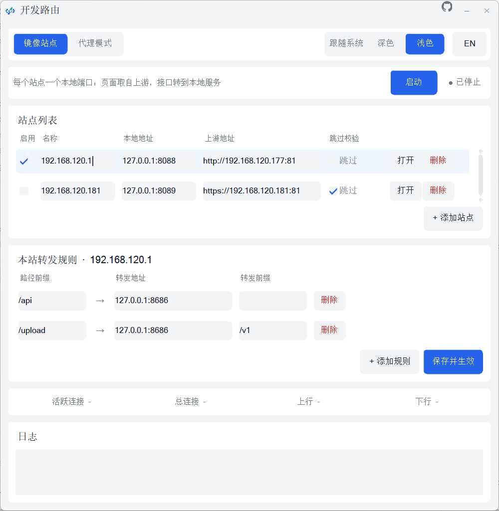
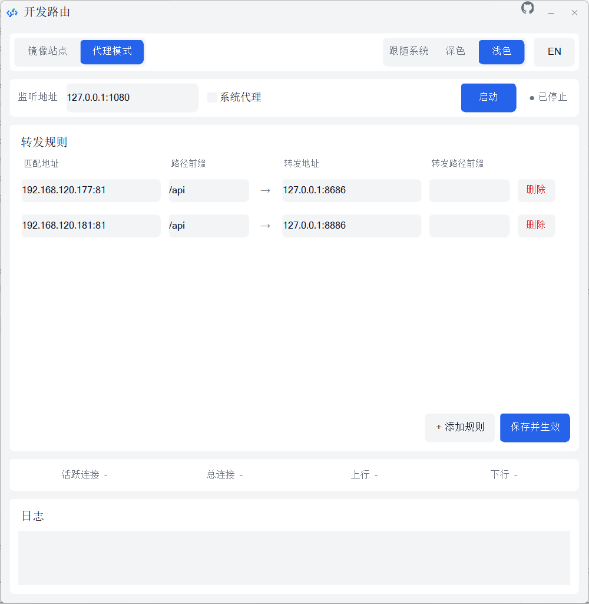
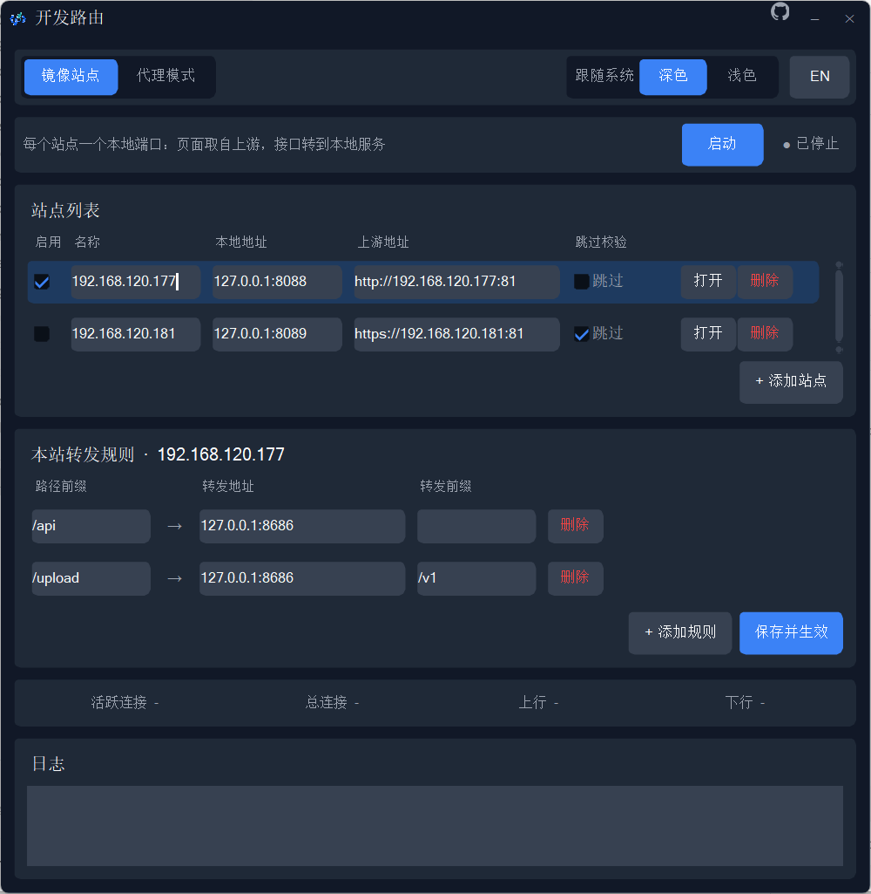
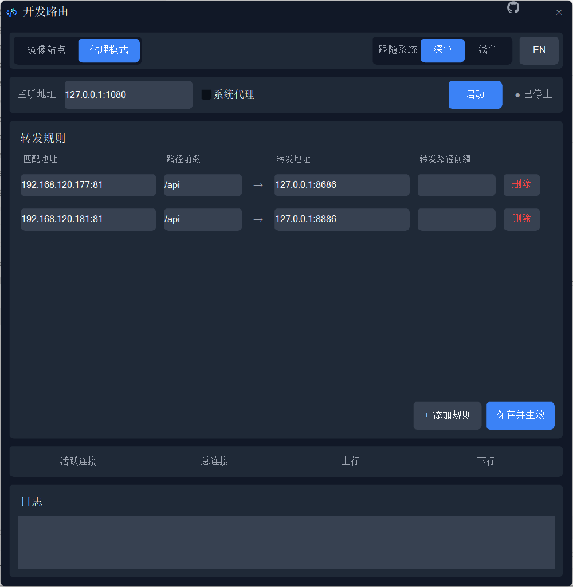

# devroute（开发路由）

[English](README_EN.md) | 中文


> 本地开发调试用的转发工具：**极致轻量，内存占用仅 3.4MB 起（无界面模式 2.5MB）**，约 4MB 单文件即拷即用。提供两种**互相独立、可各自启停**的用法：**SOCKS5/HTTP 代理**（按 `Host + 路径前缀` 转发并重写路径），以及**镜像站点**（本地开端口直接提供远端页面 + 本地接口，不依赖系统代理）。带 GUI（镜像站点 / 代理模式两个页签，镜像站点在左且默认选中；规则与站点各自配置 / 实时统计 / 日志 / 系统代理联动），Rust + FLTK **纯原生实现，非 WebView（非 Tauri/Electron）**，不内嵌浏览器内核。

## 下载

不想自己编译就直接下打包好的单文件程序（3–5 MB，依赖全部静态链接，不需要装任何运行时）：

| 平台 | 下载 | 说明 |
|---|---|---|
| Windows | [devroute-windows.exe](https://github.com/HKMV/devroute/releases/latest/download/devroute-windows.exe) | 双击即用 |
| Linux | [devroute-linux](https://github.com/HKMV/devroute/releases/latest/download/devroute-linux) | 下载后 `chmod +x devroute-linux` 再运行 |
| macOS | [devroute-macos](https://github.com/HKMV/devroute/releases/latest/download/devroute-macos) | 下载后 `chmod +x devroute-macos` 再运行 |

- 最新版本与更新日志：**https://github.com/HKMV/devroute/releases/latest**
- 全部历史版本：https://github.com/HKMV/devroute/releases

自己编译见下文 [打包分发](#打包分发)。

## 截图

| 镜像站点（默认页） | 代理模式 |
|---|---|
|  |  |

| 深色主题（镜像站点） | 深色主题（代理模式） |
|---|---|
|  |  |

## 特性

- **两种模式彻底解耦**：代理模式和镜像站点各有自己的页签、自己的配置、自己的启动/停止按钮和状态灯。可以只开镜像站点完全不开代理端口，也可以只开代理不碰站点，互不影响
- **双协议代理**：同一监听端口自动识别 SOCKS5 与 HTTP 代理（CONNECT + 绝对路径请求）
- **镜像站点（多站点）**：每个站点一个本地端口，页面取自远端站点、接口转发到本地服务；浏览器访问本地地址即可，**不依赖系统代理，也没有 CORS / Cookie 跨域问题**；支持 `http://` 与 `https://` 上游（内网自签证书可勾选跳过校验）
- **规则转发**：按 `Host:Port` + 请求路径前缀匹配，转发到目标地址并重写路径前缀。代理模式用自己的 `[[proxy_rules]]`（按 host 匹配），镜像站点用内嵌在每个站点里的 `[[sites.rules]]`（只按路径前缀匹配），两套规则互不干扰
- **页面转发提示条**：代理模式下访问命中规则的页面时，页面顶部中间显示半透明提示条（匹配路径 → 转发地址 + 转发前缀），一目了然哪些请求在转发；注入响应禁用浏览器缓存，停止代理后刷新即消失（开启前已缓存的页面需 Ctrl+F5 强刷一次）
- **镜像页面署名条**：镜像站点转发的 HTML 页面底部中间固定显示「由 devroute 提供支持」（英文界面为 `Powered by devroute`），纯内联样式、不依赖任何外部资源、不挡点击；只注入完整文档，AJAX 返回的 HTML 片段和 JS/CSS/JSON 一律不动
- **崩溃残留自清理**：程序意外退出残留的系统代理设置，下次启动时自动识别并清除，不会把死代理“还原”回去
- **运行状态图标**：代理启停时任务栏与界面左上角图标同步变色（Windows / Linux X11 有效；macOS Dock 显示应用图标，界面内图标仍有效）
- **GUI 桌面端**（默认）：顶部两个页签（镜像站点 / 代理模式，站点在左且默认打开）各管一摊，站点与规则增删改、保存热重载、一键用浏览器打开站点、连接/流量统计、实时日志、一键系统代理、深浅色主题、中英文界面；标题栏最小化按钮左边有 **GitHub 图标按钮**，一键打开项目主页
- **轻量**：GUI 空闲约 3.4MB 内存（开启代理 ~4MB，随请求量增长）；`--headless` 无界面模式约 2.5MB，适合常驻
- 自动生成默认 `config.toml`，配置文件改动即时生效
- 转发失败可返回 503 或回退原始地址

## 快速开始

### 构建要求

- Rust（edition 2024）
- Windows: CMake + MSVC（fltk 需要编译 C++，`winget install Kitware.CMake`）
- macOS / Linux: cmake + C++ 工具链

### 运行

```bash
# GUI 模式（默认）
cargo run --release

# 无界面代理模式
cargo run --release -- --headless
```

首次运行会在当前目录生成默认 `config.toml`。

### 打包分发

```bash
cargo build --release
```

产物是单文件 `target/release/devroute.exe`（Windows），所有依赖（含 fltk GUI）静态链接，无需安装任何运行时，拷贝到任意目录双击即用。

- 双击 / 直接运行 → GUI 模式
- `devroute.exe --headless` → 无界面代理模式

注意：配置文件读取的是**程序运行时所在的目录**下的 `config.toml`，不存在则自动生成默认配置。

### GUI 使用

界面顶部是两个页签，两套配置和启停完全分开，统计和日志共用底部。**默认打开的是左边的“镜像站点”页**：

**镜像站点页（左，默认）**

- **站点列表**：每个站点一个本地端口 + 一个上游地址。勾选“启用”后点“启动”，浏览器打开“本地地址”看到的就是上游页面。行内“打开”按钮直接用默认浏览器访问；“跳过”= 不校验上游证书（内网自签证书用）
- **本站转发规则**：点站点列表里的任意一行（含行内的输入框/复选框），下面就换成编辑这个站点的规则（路径前缀 → 本地地址 + 转发前缀），标题会显示当前站点名。每个站点各存一份规则，和代理模式的规则互不相干
- 点击“保存并生效”写入配置：只改规则时热更新（连接不断），改了端口/上游/启用状态会自动重启站点

**代理模式页（右）**

- **监听地址**：本地代理端口，默认 `127.0.0.1:1080`
- **系统代理**：勾选后，启动时代理自动写入系统设置（Windows 注册表 / macOS networksetup / Linux gsettings），停止或关窗时自动取消
- **转发规则**：匹配地址 + 路径前缀 → 转发地址 + 路径前缀，点击“保存并生效”写入 `config.toml` 并热重载（改监听地址会自动重启代理）

**通用**

- **主题**：右上角分段控件，跟随系统 / 深色 / 浅色，即时切换并记忆
- **语言**：主题控件旁按钮，中英文互切，即时切换并记忆

## 配置规则

`config.toml` 示例（两种模式各管各的）：

```toml
# ---------- 代理模式 ----------
proxy_listen = "127.0.0.1:1080"   # SOCKS5/HTTP 代理端口
proxy_enable = true               # 仅 --headless 使用；GUI 由代理页的启动按钮决定
theme = "system"                  # system | dark | light（GUI）
language = "auto"                 # auto | zh | en（GUI；auto = 跟随系统）
auto_proxy = false                # 启动代理时自动设置系统代理（GUI）

[[proxy_rules]]                   # 代理模式专用：按 Host + 路径前缀匹配
matcher = { addr = "192.168.120.177:81", path_prefix = "/api" }
forward = { addr = "127.0.0.1:8686", path_prefix = "" }

# ---------- 镜像站点 ----------
[[sites]]
enable = true
name = "调试站"                                  # 备注名，只用于界面/日志
listen_addr = "127.0.0.1:8088"                   # 浏览器访问这个地址
upstream = "http://192.168.120.177:81"           # 支持 http:// 与 https://
insecure = false                                 # true = 跳过上游证书校验（内网自签）

[[sites.rules]]                                  # 本站点专用：只按路径前缀匹配
path_prefix = "/api"
forward_addr = "127.0.0.1:8686"
forward_prefix = ""

[[sites]]
enable = true
name = "测试环境"
listen_addr = "127.0.0.1:8089"
upstream = "https://test.example.com"
insecure = true

[[sites.rules]]
path_prefix = "/api"
forward_addr = "127.0.0.1:8686"
forward_prefix = ""
```

字段说明：

- `proxy_listen`：代理模式监听地址
- `proxy_enable`：`--headless` 时是否起代理监听。GUI 里忽略此项，用代理页的启动按钮控制
- `sites[].listen_addr`：本地访问入口（`0.0.0.0` 也能写，重写时按 `127.0.0.1` 处理）
- `sites[].upstream`：上游站点地址，`https://` 需要写端口或用默认 443
- `sites[].insecure`：跳过证书校验，只给内网自签证书用
- `sites[].rules[].path_prefix`：命中这个路径前缀就转本地（留空 = 该站点所有请求都转本地）
- `sites[].rules[].forward_addr`：转发到本地服务 `host:port`（留空的规则会被忽略）
- `sites[].rules[].forward_prefix`：转发时替换原路径前缀的目标前缀（留空 = 去掉前缀）
- `proxy_rules[].matcher.addr`：待匹配的目标 `Host:Port`，支持 `*` 匹配所有
- `proxy_rules[].matcher.path_prefix`：需要匹配的请求路径前缀
- `proxy_rules[].forward.addr`：转发目标地址
- `proxy_rules[].forward.path_prefix`：转发时替换原路径前缀的目标前缀（留空 = 去掉前缀）

例：请求 `http://192.168.120.177:81/api/users` → 转发为 `http://127.0.0.1:8686/users`

> 旧配置兼容：`listen_addr` 和 `[[rules]]` 仍能读进来（分别视作 `proxy_listen` 和 `[[proxy_rules]]`），保存时会写成新格式。旧版规则不再作用于镜像站点——站点规则要写进各自的 `[[sites.rules]]`。

## 使用方式

### 方式一：镜像站点（推荐，不用改系统代理）

1. 在 `[[sites]]` 里配好本地端口和上游地址，站点自己的转发规则写在紧跟它的 `[[sites.rules]]` 里（或直接在 GUI 的“镜像站点”页签里填）
2. 点镜像站点页的“启动”，用浏览器打开 `http://127.0.0.1:8088`
3. 页面来自上游站点，命中站点规则的请求（如 `/api`）转发到本地服务

和系统代理方案的区别：

- **不改任何系统设置**，不会和 Clash 之类已有的代理冲突
- **同源**：页面和接口都是 `127.0.0.1:8088`，没有 CORS 预检、Cookie 天然带得上、SSE/WebSocket 正常
- **和代理模式互不干扰**：可以只开站点、完全不起代理端口；规则也各管各的
- 多个站点可以同时开（各占一个本地端口），也可以把地址直接发给同事

原理上它是一个本地反向代理，会把上游 origin 改写到本地 origin：响应体（HTML/JS/CSS/JSON）里的绝对地址、`Set-Cookie` 的 `Domain`、`Location` 重定向都会改写，`CSP`、`Alt-Svc`、`integrity`（SRI）会被去掉，因为改写后的内容对不上原哈希。请求上游时固定发 `Accept-Encoding` 以外的原始头、`Host` 还原成上游地址，所以 vhost 和 Origin 校验都能过。

已知边界：

- 页面里**写死在二进制/压缩内容**里的地址改不了（正常前端产物不会这样）
- 上游强制 gzip/brotli 的响应会原样透传（不改写），此时若页面用相对路径仍然正常
- 单个响应超过 8MB 不改写，按流式透传
- `https://` 上游需要能通过证书校验，内网自签请开 `insecure`
- WebSocket 和 chunked 流式上传（`fetch` + `ReadableStream`）整条走隧道，本身正常，但那一次响应不做改写

### 方式二：系统代理

GUI 勾选"系统代理"后启动即可，浏览器和大多数应用自动走代理。

### 方式三：ZeroOmega 浏览器插件

1. Chrome/Edge 安装 `ZeroOmega` 扩展
2. 添加代理：类型 `SOCKS5`，地址 `127.0.0.1:1080`（或直接填 `socks5://127.0.0.1:1080`）
3. 按需配置规则：全局走代理由 `config.toml` 分流，或只把目标调试域名设为走代理

## 示例场景

### 镜像站点调试（不用系统代理）

```toml
[[sites]]
enable = true
name = "内网测试环境"
listen_addr = "127.0.0.1:8088"
upstream = "http://192.168.120.177:81"
insecure = false

[[sites.rules]]
path_prefix = "/api"
forward_addr = "127.0.0.1:8686"
forward_prefix = ""
```

浏览器打开 `http://127.0.0.1:8088` → 页面来自 `192.168.120.177:81`，`/api/*` 打到本机 `8686`。

### 本地 API 转发

浏览器访问 `http://192.168.120.177:81/api/test` → 转发到 `http://127.0.0.1:8686/test`

### 多域名分流（代理模式）

```toml
[[proxy_rules]]
matcher = { addr = "api.example.com:80", path_prefix = "/service" }
forward = { addr = "127.0.0.1:8080", path_prefix = "/" }

[[proxy_rules]]
matcher = { addr = "*", path_prefix = "/static" }
forward = { addr = "127.0.0.1:8090", path_prefix = "/assets" }
```

## 项目结构

```text
src/
  main.rs            # 入口：--headless 走命令行，否则起 GUI
  daemon.rs          # 后台运行时：代理监听（spawn_proxy）与站点监听（spawn_sites）各自独立
  core/
    socks.rs         # SOCKS5 处理 + 协议嗅探（首字节 0x05 判定）
    http.rs          # HTTP 路径重写 + HTTP 代理（CONNECT / absolute-form）+ 页面提示条注入
    mirror.rs        # 镜像站点：本地端口反向代理 + origin 改写 + TLS 上游 + WebSocket 隧道
    route.rs         # 路由规则匹配（按 host+前缀 / 站点内按前缀，RwLock 热更新）
    config.rs        # 配置加载/保存（内联表 TOML；兼容旧的 listen_addr / [[rules]]）
    stats.rs         # 连接/流量原子计数
  ui/
    mod.rs           # GUI 入口：主题检测、事件循环、日志通道
    view.rs          # 界面构建与扁平化样式（fltk，两个页签）
    controller.rs    # 业务逻辑：两套独立启停、站点/规则编辑、保存、系统代理、主题切换
```

## License

MIT
