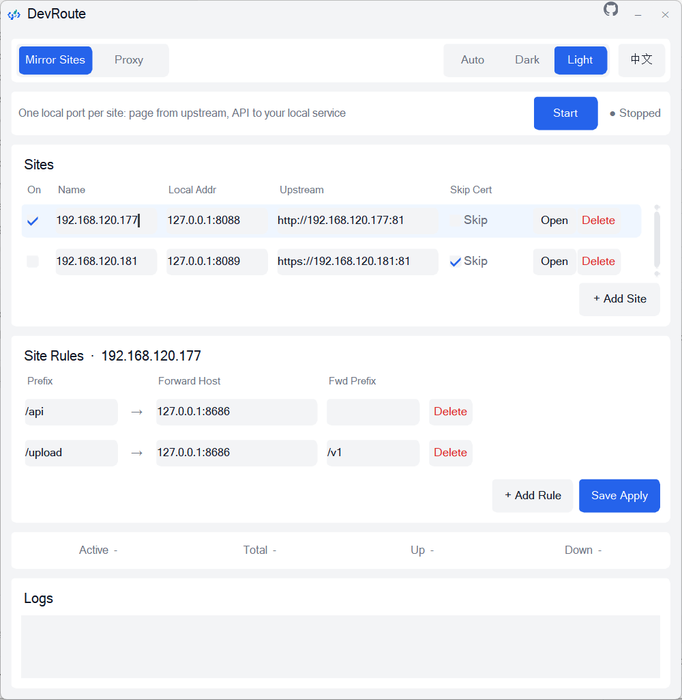
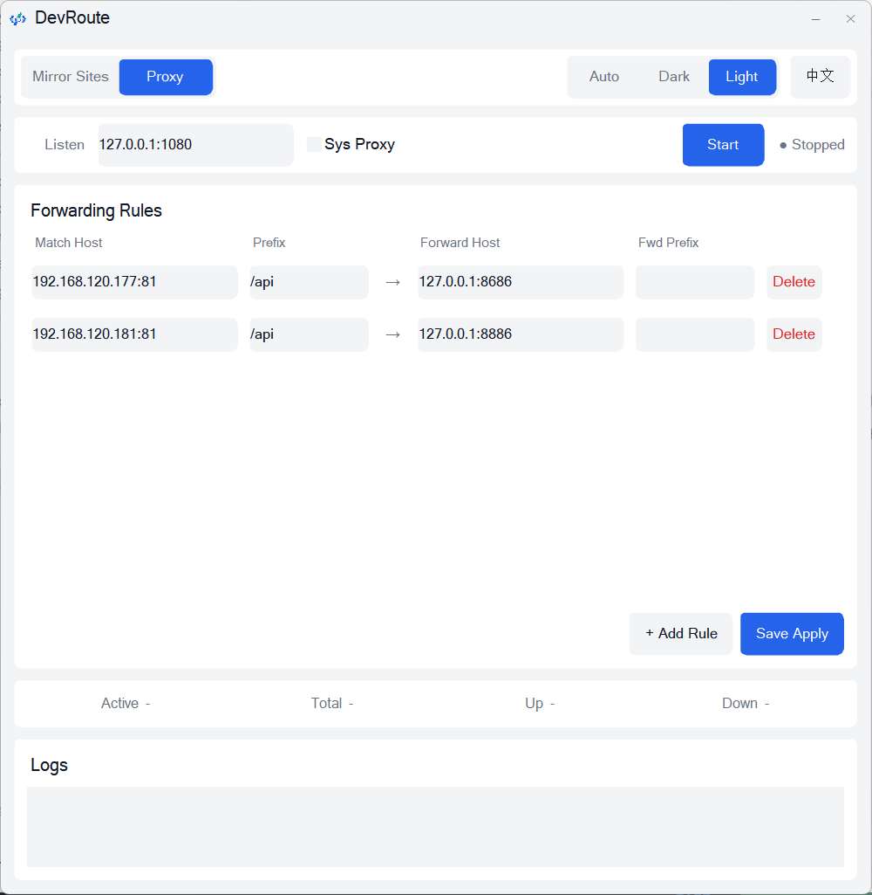
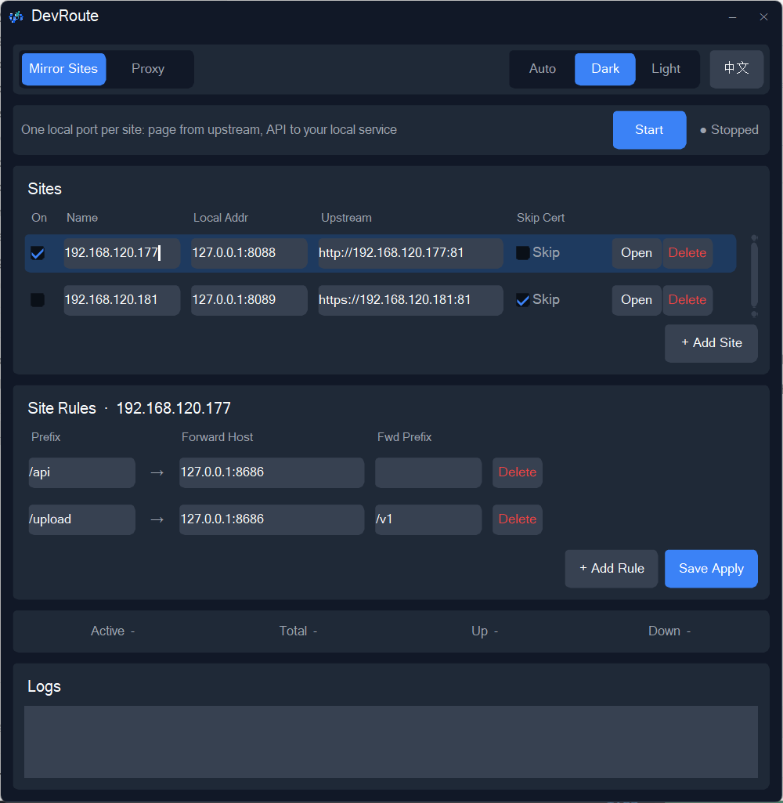
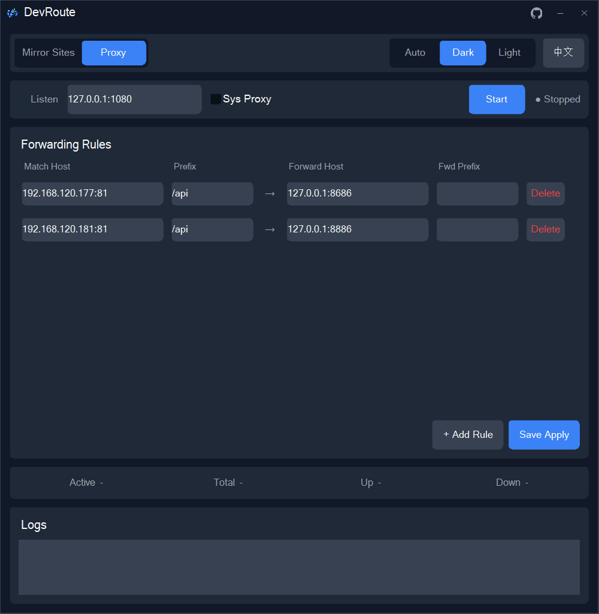
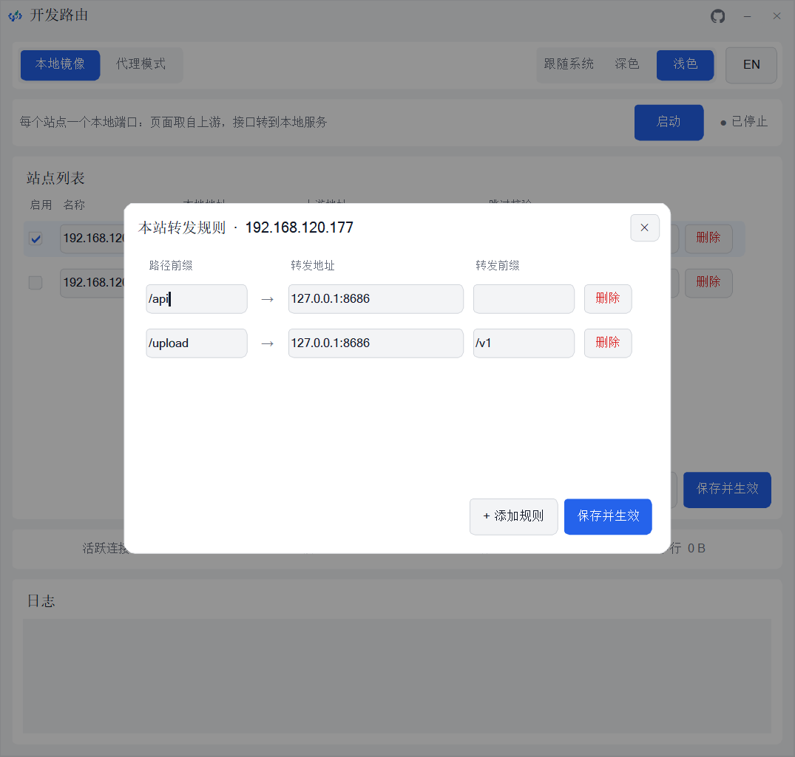
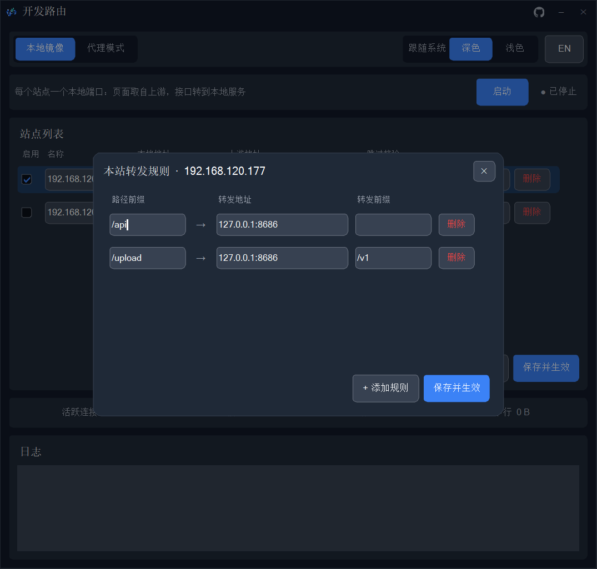

# devroute


[English](README_EN.md) | 中文

> A local forwarding tool for development & debugging: **extremely lightweight, ~3.4MB RAM idle with GUI (2.5MB headless)**, a single ~3MB binary you can copy anywhere. Two **independent, separately startable** ways to use it: a **SOCKS5/HTTP proxy** (forward by `Host + path prefix` with path rewriting) and **local mirrors** (serve the remote frontend from a local port and route API calls to your local service — no system proxy involved). Ships with a GUI (two tabs — local mirrors and proxy, local mirrors first and selected by default — each with its own rules / live stats / logs / system proxy integration), built in Rust + FLTK **fully native — no WebView (not Tauri/Electron)**, no embedded browser engine.

## Download

Don't want to build it yourself? Grab the prebuilt single-file binary (Windows 2.9 MB / macOS 2.6 MB / Linux 4.4 MB, fully static, no runtime required):

| Platform | Download | Notes |
|---|---|---|
| Windows | [devroute-windows.exe](https://github.com/HKMV/devroute/releases/latest/download/devroute-windows.exe) | Double-click to run |
| Linux | [devroute-linux](https://github.com/HKMV/devroute/releases/latest/download/devroute-linux) | `chmod +x devroute-linux`, then run |
| macOS | [devroute-macos](https://github.com/HKMV/devroute/releases/latest/download/devroute-macos) | `chmod +x devroute-macos`, then run |

- Latest release & changelog: **https://github.com/HKMV/devroute/releases/latest**
- All releases: https://github.com/HKMV/devroute/releases

Building from source is described [below](#packaging--distribution).

## Screenshots

| Local mirrors (default tab) | Proxy mode |
|---|---|
|  |  |

| Dark theme (local mirrors) | Dark theme (proxy mode) |
|---|---|
|  |  |

Site rules dialog (opens from the **Configure** button on a site row):

| Light | Dark |
|---|---|
|  |  |

## Features

- **Two fully decoupled modes**: proxy mode and local mirrors each have their own tab, their own settings, and their own start/stop button and status light. Run local mirrors with the proxy port completely closed, or run the proxy without touching sites — neither affects the other
- **Dual-protocol proxy**: a single listening port auto-detects SOCKS5 and HTTP proxy traffic (CONNECT + absolute-form requests)
- **Local mirrors (multiple)**: each site gets a local port; the page comes from the remote site while API paths are forwarded to your local service. Just open the local URL — **no system proxy, no CORS or cross-site cookie pain**. Upstreams may be `http://` or `https://` (self-signed internal certs supported via "skip cert check")
- **Rule-based forwarding**: match by `Host:Port` + request path prefix, forward to the target and rewrite the path prefix. Proxy mode uses `[[proxy_rules]]` (matched by host), each local mirror uses its own embedded `[[sites.rules]]` (matched by path prefix only) — the two rule sets never interfere
- **On-page forwarding banner**: in proxy mode, pages matching a rule get a translucent banner at top-center (matched path → forward target + prefix), making it obvious what's being forwarded; injected responses are marked `no-store` so the banner disappears once the proxy stops (pages cached before enabling need one hard refresh, Ctrl+F5)
- **Mirrored-page badge**: HTML pages served through a local mirror get a fixed bottom-center badge — `Powered by devroute` in the English UI, 由 devroute 提供支持 in Chinese. Inline styles only, no external assets, never blocks clicks; injected only into full documents, so HTML fragments from AJAX plus JS/CSS/JSON are left untouched
- **Crash leftover cleanup**: system proxy settings left behind by an unexpected exit are detected and cleared on next launch — a dead proxy is never "restored"
- **Running-state icon**: taskbar and in-app icon change color with proxy start/stop (Windows / Linux X11; on macOS the Dock shows the app icon, but the in-app icon still reflects state)
- **GUI desktop app** (default): two tabs up top (local mirrors / proxy mode, sites on the left and open by default), each managing its own settings — site & rule CRUD, save with hot reload, open a site in the browser with one click, connection/traffic stats, live logs, one-click system proxy, light/dark theme, Chinese/English UI; per-site rules are edited in a centered dialog (translucent scrim + rounded card, click outside to close) and the lists go read-only once started; the three title-bar buttons (GitHub / minimize / close) share the same size and baseline with a hover highlight, and the **GitHub button** opens the project page and shows the repo URL on hover
- **Lightweight**: ~3.4MB idle with GUI (~4MB while proxying, grows with traffic); `--headless` mode sits at ~2.5MB, ideal for leaving running
- Auto-generates a default `config.toml`; config changes take effect immediately
- Failed forwards return 503 or fall back to the original address

## Quick Start

### Build Requirements

- Rust (edition 2024)
- Windows: CMake + MSVC (fltk compiles C++, `winget install Kitware.CMake`)
- macOS / Linux: cmake + a C++ toolchain

### Run

```bash
# GUI mode (default)
cargo run --release

# Headless proxy mode
cargo run --release -- --headless
```

A default `config.toml` is generated in the current directory on first run.

### Packaging & Distribution

```bash
cargo build --release
```

The output is a single `target/release/devroute.exe` (Windows); all dependencies (including the fltk GUI) are statically linked — no runtime to install, just copy the file anywhere and double-click.

- Double-click / run directly → GUI mode
- `devroute.exe --headless` → headless proxy mode

Note: the config file is `config.toml` in the **directory the program runs from**; it is auto-generated with defaults if missing.

### Using the GUI

The window has two tabs at the top. Settings and start/stop are fully separate; stats and logs are shared at the bottom. **The left tab — local mirrors — is what opens by default.**

**Local mirrors tab (left, default)**

- **Site list**: each row is one local port plus one upstream. Enable it, hit "Start", and the local address shows the upstream page. The row's "Open" button launches your default browser; "Skip" disables upstream certificate verification (for self-signed internal certs)
- **Site rules**: click the **Configure** button on a site row to open a centered dialog (translucent scrim + rounded card) with that site's own rules (path prefix → local address + forward prefix); the title shows the site name, and clicking the scrim or the ✕ closes it. Every site keeps its own rule list, unrelated to the proxy rules
- **Click a row to select it**: clicking anywhere on a site row (including its inputs) selects that row and focuses the input, so one click is enough to start editing
- **Read-only while running**: once the site service is started the site list and the rules dialog are disabled as a whole ("Configure" and "Open" still work) so nobody assumes an edit already took effect; stopping restores editing
- "Save changes" writes the config (there is one at the bottom of the page and one inside the rules dialog — both do the same): rule-only changes hot reload without dropping connections; changing a port/upstream/enabled flag restarts the sites

**Proxy mode tab (right)**

- **Listen address**: local proxy port, default `127.0.0.1:1080`
- **System proxy**: when checked, starting the proxy writes system settings automatically (Windows registry / macOS networksetup / Linux gsettings), and reverts on stop or window close
- **Forwarding rules**: match host + path prefix → forward host + path prefix; click "Save changes" to write `config.toml` and hot reload (changing the listen address restarts the proxy)

**Shared**

- **Theme**: segmented control top-right — Auto / Dark / Light, applied instantly and remembered
- **Language**: button next to the theme control toggles Chinese/English, applied instantly and remembered
- **Title bar**: three buttons top-right (GitHub project page / minimize / close); drag any empty spot to move the window

## Changelog

Per-release details live in **[CHANGELOG.md](CHANGELOG.md)** (the release workflow copies the matching section into each GitHub Release):

- **0.9.0**: site rules moved into a centered dialog (translucent scrim + rounded card), "Save changes" back at the bottom of the sites page, lists go read-only while running, outlined row buttons, slimmer scrollbars
- **0.8.2**: size-first release profile — the Windows binary drops from 4.6 MB to 2.9 MB (-38%); release notes are now generated from CHANGELOG
- **0.8.1**: GitHub icon in the title bar now lines up with the minimize / close buttons; docs screenshots are captured with `PrintWindow`
- **0.8.0**: badge at the bottom of mirrored pages (`Powered by devroute`), GitHub icon button in the title bar, fixed the large empty gap left after deleting list rows
- All releases: [Releases](https://github.com/HKMV/devroute/releases)

## Rule Configuration

Example `config.toml` (each mode keeps to itself):

```toml
# ---------- proxy mode ----------
proxy_listen = "127.0.0.1:1080"   # SOCKS5/HTTP proxy port
proxy_enable = true               # used by --headless only; the GUI decides via its Start button
theme = "system"                  # system | dark | light (GUI)
language = "auto"                 # auto | zh | en (GUI; auto = follow system)
auto_proxy = false                # set system proxy on start (GUI)

[[proxy_rules]]                   # proxy mode only: matched by Host + path prefix
matcher = { addr = "192.168.120.177:81", path_prefix = "/api" }
forward = { addr = "127.0.0.1:8686", path_prefix = "" }

# ---------- local mirrors ----------
[[sites]]
enable = true
name = "dev site"                                # label for the UI / logs only
listen_addr = "127.0.0.1:8088"                   # open this in the browser
upstream = "http://192.168.120.177:81"           # http:// or https://
insecure = false                                 # true = skip upstream cert verification

[[sites.rules]]                                  # this site only: matched by path prefix
path_prefix = "/api"
forward_addr = "127.0.0.1:8686"
forward_prefix = ""

[[sites]]
enable = true
name = "test env"
listen_addr = "127.0.0.1:8089"
upstream = "https://test.example.com"
insecure = true

[[sites.rules]]
path_prefix = "/api"
forward_addr = "127.0.0.1:8686"
forward_prefix = ""
```

Field reference:

- `proxy_listen`: proxy mode listen address
- `proxy_enable`: whether `--headless` starts the proxy listener. The GUI ignores it and uses the Start button instead
- `sites[].listen_addr`: local entry point (`0.0.0.0` works too; rewrites still use `127.0.0.1`)
- `sites[].upstream`: upstream site address; for `https://` either write the port or rely on 443
- `sites[].insecure`: skip certificate verification (self-signed internal certs only)
- `sites[].rules[].path_prefix`: requests with this prefix go to the local service (empty = every request of this site)
- `sites[].rules[].forward_addr`: local service `host:port` (rules with an empty address are ignored)
- `sites[].rules[].forward_prefix`: prefix that replaces the original path prefix on forward (empty = strip the prefix)
- `proxy_rules[].matcher.addr`: target `Host:Port` to match; `*` matches everything
- `proxy_rules[].matcher.path_prefix`: request path prefix to match
- `proxy_rules[].forward.addr`: address to forward to
- `proxy_rules[].forward.path_prefix`: prefix that replaces the original path prefix on forward (empty = strip the prefix)

Example: request `http://192.168.120.177:81/api/users` → forwarded to `http://127.0.0.1:8686/users`

> Legacy configs still load: `listen_addr` and `[[rules]]` are read as `proxy_listen` and `[[proxy_rules]]`, and are rewritten in the new format on save. Old rules no longer apply to local mirrors — put each site's rules under its own `[[sites.rules]]`.

## Usage

### Option 1: Local mirror (recommended — no system proxy changes)

1. Configure a `[[sites]]` entry and put that site's forward rules in the `[[sites.rules]]` that follows it (or fill both in on the GUI's "Local Mirrors" tab)
2. Hit "Start" and open `http://127.0.0.1:8088` in a browser
3. The page comes from the upstream site; requests matching the site's rules (e.g. `/api`) go to your local service

How it differs from the system-proxy approach:

- **No system settings touched**, so it never fights an existing proxy (Clash and friends)
- **Same origin**: page and API are both `127.0.0.1:8088` — no CORS preflights, cookies just work, SSE/WebSocket behave normally
- **Independent from proxy mode**: you can run local mirrors with the proxy port completely closed, and the two rule sets don't touch each other
- Several sites can run at once (one local port each), and you can hand the URL to a colleague

Under the hood it is a local reverse proxy that rewrites the upstream origin to the local one: absolute URLs inside HTML/JS/CSS/JSON, `Set-Cookie` `Domain`, and `Location` redirects are rewritten, while `CSP`, `Alt-Svc` and `integrity` (SRI) are dropped because rewritten content no longer matches the original hashes. Upstream requests keep their original headers (minus `Accept-Encoding`) and restore `Host`, so vhost and Origin checks still pass.

Known limits:

- URLs baked into binary or compressed payloads cannot be rewritten (normal frontend builds don't do this)
- Responses that force gzip/brotli are passed through untouched; relative paths still work in that case
- Single responses over 8MB are streamed instead of rewritten
- `https://` upstreams must pass certificate verification; use `insecure` for self-signed internal certs
- WebSockets and chunked streaming uploads (`fetch` + `ReadableStream`) are tunneled end to end — they work, but that one response is not rewritten

### Option 2: System proxy

Check "System Proxy" in the GUI and start — browsers and most apps route through the proxy automatically.

### Option 3: ZeroOmega browser extension

1. Install the `ZeroOmega` extension in Chrome/Edge
2. Add a proxy: type `SOCKS5`, address `127.0.0.1:1080` (or just `socks5://127.0.0.1:1080`)
3. Configure rules as needed: route everything through the proxy and let `config.toml` split traffic, or only route the domains you're debugging

## Example Scenarios

### Mirror-site debugging (no system proxy)

```toml
[[sites]]
enable = true
name = "internal test env"
listen_addr = "127.0.0.1:8088"
upstream = "http://192.168.120.177:81"
insecure = false

[[sites.rules]]
path_prefix = "/api"
forward_addr = "127.0.0.1:8686"
forward_prefix = ""
```

Open `http://127.0.0.1:8088` → the page comes from `192.168.120.177:81`, `/api/*` hits local `8686`.

### Local API forwarding

Browser requests `http://192.168.120.177:81/api/test` → forwarded to `http://127.0.0.1:8686/test`

### Multi-domain routing (proxy mode)

```toml
[[proxy_rules]]
matcher = { addr = "api.example.com:80", path_prefix = "/service" }
forward = { addr = "127.0.0.1:8080", path_prefix = "/" }

[[proxy_rules]]
matcher = { addr = "*", path_prefix = "/static" }
forward = { addr = "127.0.0.1:8090", path_prefix = "/assets" }
```

## Project Structure

```text
src/
  main.rs            # Entry: --headless → CLI mode, otherwise GUI
  daemon.rs          # Background runtime: spawn_proxy and spawn_sites are independent
  core/
    socks.rs         # SOCKS5 handling + protocol sniffing (first byte 0x05)
    http.rs          # HTTP path rewriting + HTTP proxy (CONNECT / absolute-form) + on-page banner injection
    mirror.rs        # Local mirror: local reverse proxy + origin rewriting + TLS upstreams + WebSocket tunneling
    route.rs         # Route rule matching (host+prefix for proxy, prefix-only per site; hot-updated via RwLock)
    config.rs        # Config load/save (inline-table TOML; reads legacy listen_addr / [[rules]])
    stats.rs         # Atomic connection/traffic counters
  ui/
    mod.rs           # GUI entry: theme detection, event loop, log channel
    view.rs          # Widget construction & flat styling (fltk, two tabs)
    controller.rs    # Logic: two independent start/stop paths, site/rule editing, saving, system proxy, theme & language switching
```

## License

MIT
